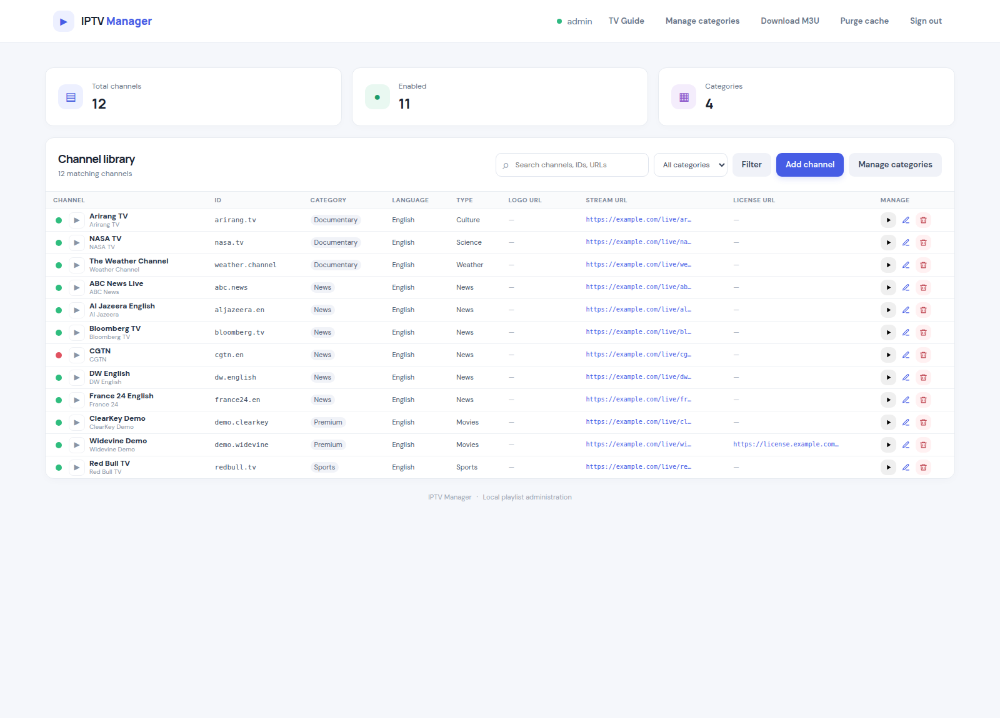
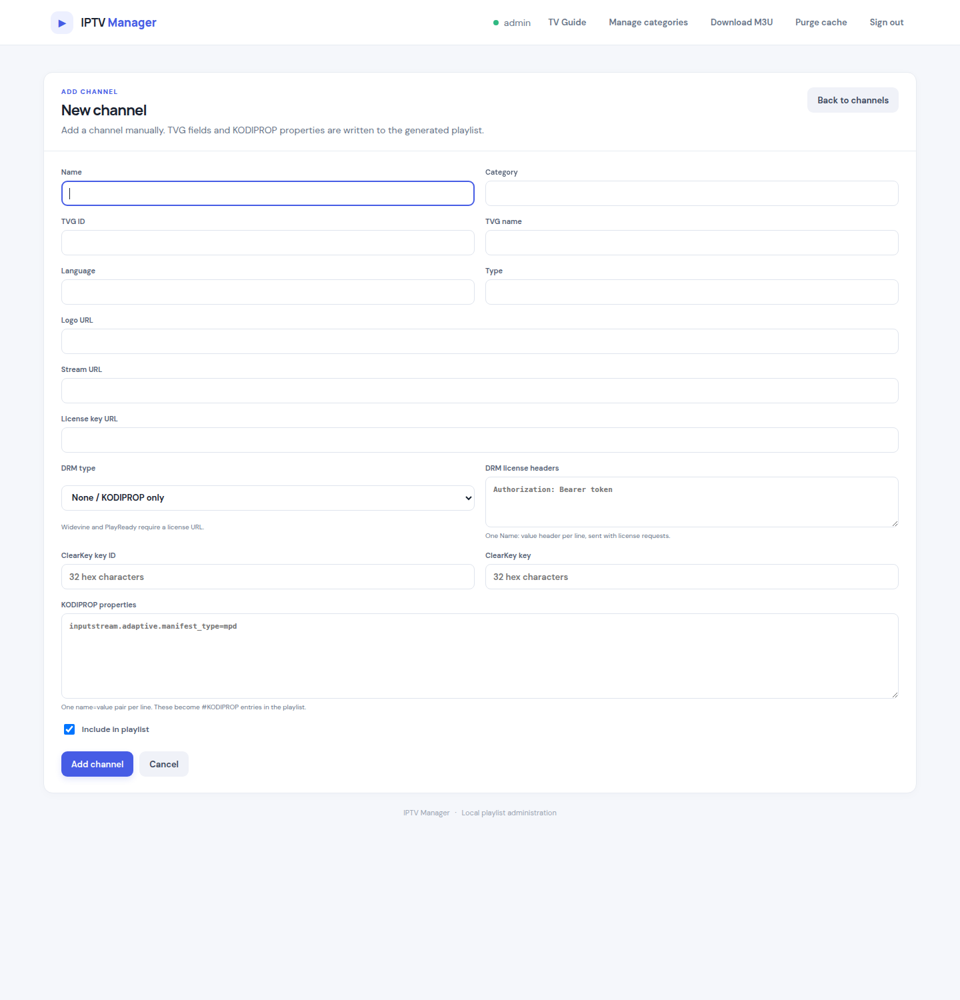
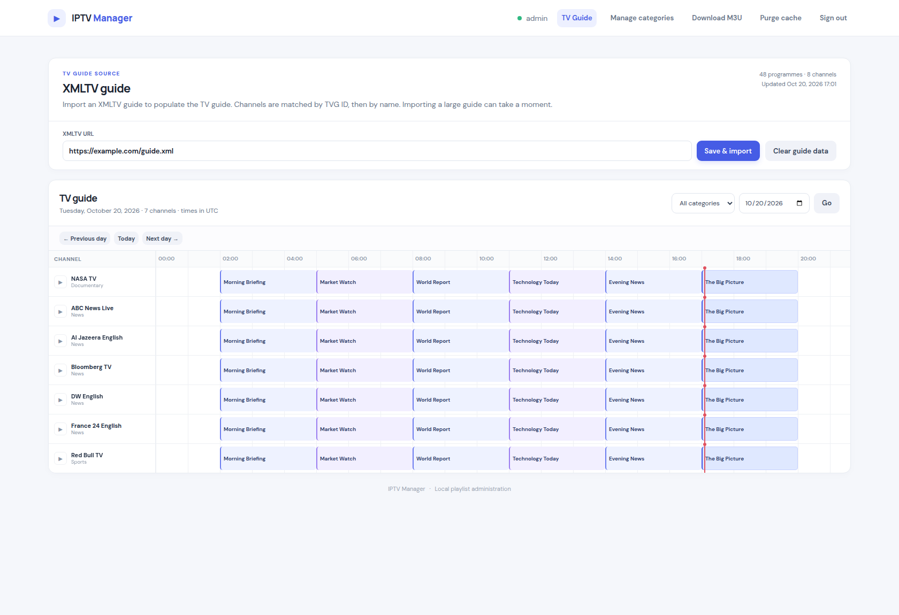
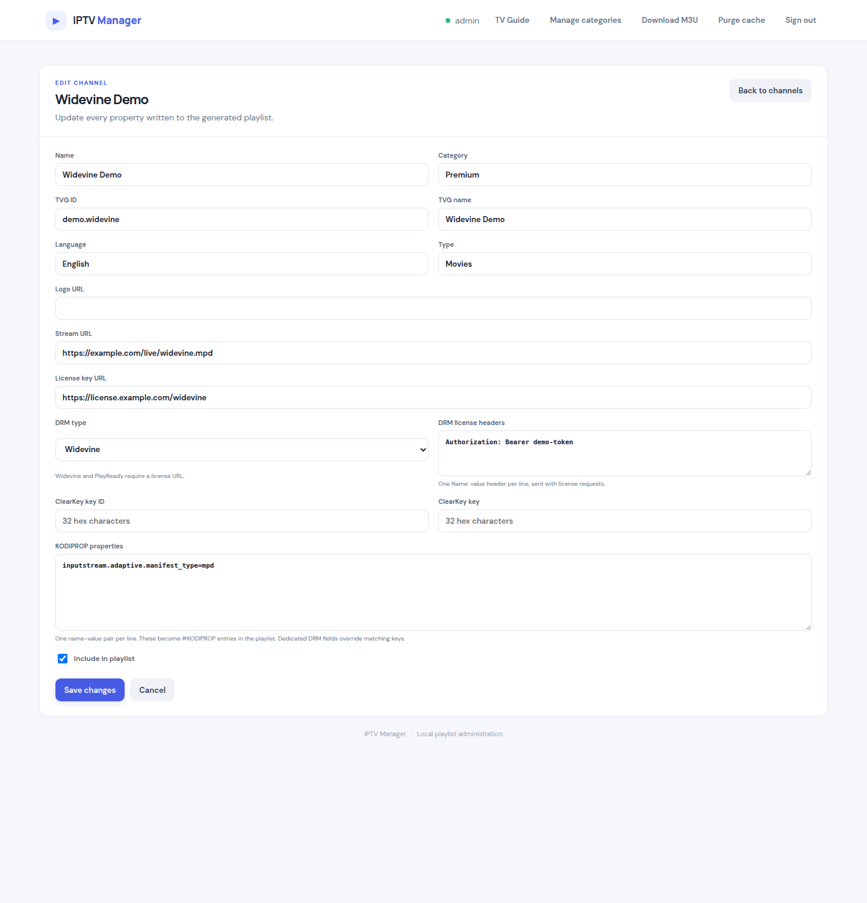
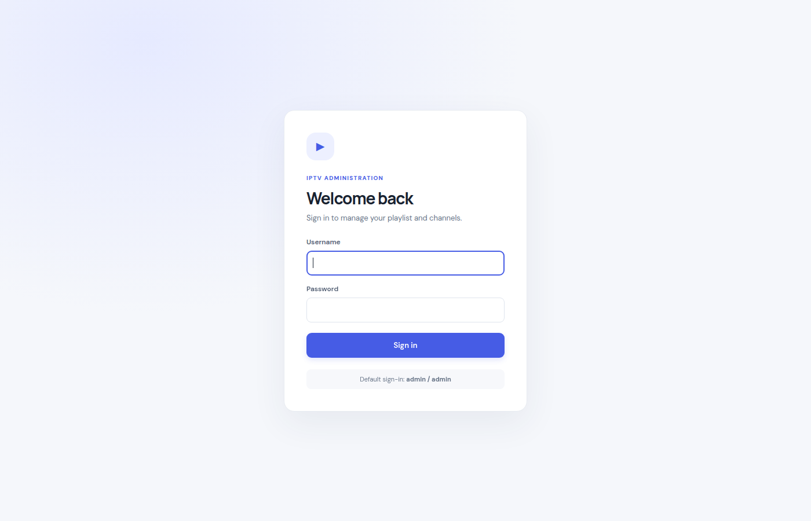

# IPTV Manager

A self-contained PHP + SQLite web app for managing an IPTV channel library, generating M3U playlists, importing an XMLTV TV guide, and previewing channels — including DRM-protected ones — directly in the browser.



## Features

**Channel library**
- Every channel can have multiple feeds (stream variants), each encrypted or clear
- Compact channel table with enable/disable status dot, logo, TVG ID, category, language, type, and feed visibility summary
- Search and category filtering with pagination
- Add / edit / delete channels and manage their feeds, or import an existing M3U playlist
- Bulk select and delete channels (select-all on the current page)

**Playlist import**
- Import channels from an M3U/M3U8 playlist — uploaded as a file or fetched from a URL (gzip supported)
- Idempotent: entries sharing a channel name become feeds of one channel; re-imports update feeds in place and keep their enable/visibility settings
- `#KODIPROP` DRM settings (`license_type` / `license_key`, including license request headers) are mapped to the dedicated DRM fields
- Inline SVG icon actions for play, edit, and delete
- Category management: rename to merge, delete empty categories

**Channel export / import (JSON backup)**
- **Export channels** downloads a JSON snapshot of the whole library — every channel with its feeds, logo, category, language, properties, feed visibility and DRM settings
- Filters: all channels, enabled only, disabled only, or a single category; DRM keys and license URLs can be left out
- **Import channel export** restores such a file: *merge* adds and updates the channels it contains, *replace* deletes every channel first and restores the file exactly (with an explicit confirmation)
- Channels are matched by their export id first and by name second, so importing the same file twice never creates duplicates
- The file is plain JSON (`format: iptv-manager-channels`) and can be edited or filtered before it is imported again
- The TV guide is not part of the export — it is imported separately from the XMLTV source

**Playlist feed**
- Cached M3U feed served on its own port; only enabled channels and feeds are included
- Each feed chooses where it appears: playlist server, clear server, or both
- Cache is versioned per mutation and validated against the SQLite file signature (`X-Playlist-Cache: HIT|MISS`, ETag / 304 support)
- Optional `x-tvg-url` header written from the configured guide source

**Auto feed (one URL for every player)**
- A dedicated port that reads the matched user-agent rule and serves the matching playlist: the **clear playlist** for players without DRM support, the **full playlist** for players that handle DRM
- One address for every player — point VLC, Kodi, TiviMate or Perfect Player at the same URL and let the rules decide
- Wildcard patterns (`VLC*`, `*Kodi*`, `TiviMate*`) and regular expressions work exactly like in the Security page
- A rule that only allows a client falls back to the default playlist of the auto port (full or clear, configurable in the UI)
- Clients that match no rule are denied with 404, like on the other feeds

**TV guide (XMLTV)**

- Synchronous XMLTV import over HTTP/HTTPS with gzip support and size caps
- Matches programmes to channels by TVG ID, then by normalized display name
- Transactional imports: a failed or empty source never wipes existing guide data
- Day navigation, category filter, current-time indicator, and pagination
- Guide data lives in its own `epg_programs` table and is pruned as it expires

**DRM support**
- Per-feed DRM type: `None / KODIPROP only`, `ClearKey`, `Widevine`, `PlayReady`
- Dedicated fields for license URL, ClearKey key ID + key, and license request headers
- Written into the generated playlist as `#KODIPROP:inputstream.adaptive.license_type` and `#KODIPROP:inputstream.adaptive.license_key` (license URL plus header segment for Kodi)
- Dedicated DRM fields override matching KODIPROP keys; feeds configured only through the KODIPROP textarea keep working unchanged

**Live log (debug mode)**
- Toggle debug mode from the **Live log** page; while on, every request to the web, playlist, clear and auto servers is recorded
- One JSON line per request in `data/requests.log` — timestamp, server, client IP, user agent, method, path, status, duration, the security decision and the playlist that was served (`full`, `clear` or `deny`)
- The page polls the log every two seconds and renders new lines live; the file auto-rotates at 1 MB (last 400 lines kept)
- Filters for text, server, status, security decision and **served playlist** (full / clear / denied)
- A blocked request gets an **Allow** button right in the log row: pick the playlist the client should receive (default, full or clear) and the matching rule is created — or an existing block rule is rewritten and moved to the top

**User-agent security**
- **Deny by default**: with enforcement on, the playlist, clear and auto feeds return **404 Not Found** to every client unless its `User-Agent` matches an allow rule
- Allow rules match the User-Agent as a case-insensitive **substring**, support `*`/`?` **wildcards** (`TiviMate*`, `*Kodi*`), or a regular expression when wrapped in delimiters (`/^VLC\/3/i`)
- Each allow rule picks what the client receives: the server's own playlist, the **full** playlist, or the **clear** playlist
- Rules can be enabled/disabled and reordered (first match wins); a tester shows which rule (if any) a given user agent matches
- Enforcement can be toggled in the UI, or defaulted through `IPTV_UA_ENFORCE` (defaults to on); matched/denied requests set an `X-UA-Rule` header and are written to the live log even when debug mode is off

**Browser preview**
- Play button on every feed (and on each channel row, using its first enabled feed) opens an inline player dialog
- HLS/DASH streams play through [Shaka Player](https://shaka-player-demo.appspot.com/) (loaded on demand from jsDelivr); MP4/WebM/Ogg use native playback
- DRM streams configure EME with `clearKeys` or license `servers`, and license request headers are attached through Shaka's networking engine



## Screenshots

| | |
|---|---|
|  |  |
| Channel library with status dots and icon actions | TV guide with current-time indicator |
|  |  |
| Editing a Widevine channel (DRM fields) | New channel form with DRM section |
|  | |
| Sign-in screen | |

## Requirements

- PHP 8.1+ (developed and tested on PHP 8.5) with `pdo_sqlite`
- No Composer dependencies, no external database, no build step

Verify your setup:

```sh
php -m | grep -i pdo_sqlite
```

## Quick start

```sh
cp .env.example .env   # optional — defaults to ports 8000/8001/8002 on 127.0.0.1
./iptv-manager start
```

Then open <http://127.0.0.1:8000> and sign in with **admin / admin**.

```sh
./iptv-manager status     # check all servers
./iptv-manager restart    # apply code changes
./iptv-manager stop       # stop all servers
./iptv-manager run        # run in the foreground (used by the system service)
```

Four servers are started:

| Service | Default URL | Purpose |
|---|---|---|
| Web UI | `http://127.0.0.1:8000` | Administration interface |
| Playlist | `http://127.0.0.1:8001` | Cached M3U feed with every feed assigned to the playlist server (`/` only; other paths redirect) |
| Clear | `http://127.0.0.1:8002` | Cached M3U feed with every feed assigned to the clear server |
| Auto | `http://127.0.0.1:8003` | One address for every player — the user-agent rule decides whether the client gets the full or the clear playlist |

You can also run the servers directly:

```sh
set -a; . ./.env; set +a
php -d upload_max_filesize=64M -d post_max_size=64M -d memory_limit=512M -S "$IPTV_HOST:$IPTV_PORT" -t . router.php
php -d upload_max_filesize=64M -d post_max_size=64M -d memory_limit=512M -S "$IPTV_HOST:$IPTV_PLAYLIST_PORT" -t . router.php
php -d upload_max_filesize=64M -d post_max_size=64M -d memory_limit=512M -S "$IPTV_HOST:$IPTV_CLEAR_PORT" -t . router.php
php -d upload_max_filesize=64M -d post_max_size=64M -d memory_limit=512M -S "$IPTV_HOST:$IPTV_AUTO_PORT" -t . router.php
```

To have them start automatically on boot, install them as a [system service](#system-service).

### Channel export and import

The web UI can export the whole channel library as a JSON file and import it back — handy for backups and for moving a library to another server.

- **Export channels** (top navigation) → pick *all / enabled / disabled* channels, optionally restrict it to one category, and optionally leave the DRM keys out → **Download JSON export** saves `iptv-manager-channels-YYYY-MM-DD.json`.
- **Import playlist** → *Import channel export* uploads that file again:
  - **Merge with the current library** — channels in the file are added or updated, everything else stays untouched.
  - **Replace every channel** — every channel is deleted first and the file becomes the new library (the checkbox confirmation is required).
- Channels are matched by the `source_id` written in the export, then by name, so the same file can be imported twice without duplicating channels.
- The file format is documented by itself (`format: "iptv-manager-channels"`, `version: 1`) and can be edited with any text editor before it is imported again.

The export is served directly by the web server, so it also works with `curl` once you are signed in:

```sh
curl -b cookies.txt "http://127.0.0.1:8000/index.php?export=channels&scope=all&category=News&drm=1" -o channels.json
```

The uploaded file must stay below the PHP upload limit; the launcher starts the servers with `upload_max_filesize=64M` and `post_max_size=64M` so even a library of tens of thousands of channels can be restored.

### Configuration

Ports and bind address are read from a `.env` file in the project root (see `.env.example`). Real environment variables always override `.env` values.

| Variable | Default | Description |
|---|---|---|
| `IPTV_HOST` | `127.0.0.1` | Bind address for all servers |
| `IPTV_PORT` | `8000` | Web UI port |
| `IPTV_PLAYLIST_PORT` | `8001` | Playlist feed port |
| `IPTV_CLEAR_PORT` | `8002` | Clear-only feed port |
| `IPTV_AUTO_PORT` | `8003` | Auto feed port — the user-agent rule picks the playlist |
| `IPTV_DEBUG` | `0` | Default live-log debug mode (overridden by the UI toggle stored in the DB) |
| `IPTV_UA_ENFORCE` | `1` | User-agent allow-list enforcement (overridden by the UI toggle stored in the DB) |
| `PHP_BIN` | `php` | PHP binary used by the launcher — must have the PDO SQLite extension |

**PHP detection.** The launcher and the service installer look for a PHP CLI binary that has `pdo_sqlite` enabled: the configured `PHP_BIN` first, then `php` from `PATH`, then the versioned binaries in `/usr/bin` and `/usr/local/bin`. A configured binary without the extension is skipped with a notice and a working one is used instead. If no PHP on the machine has `pdo_sqlite`, the service installer (running as root) installs the matching `phpX.Y-sqlite3` package automatically; otherwise the exact `apt install` command is printed.

Example: expose to a trusted LAN on other ports — edit `.env`:

```ini
IPTV_HOST=0.0.0.0
IPTV_PORT=8080
IPTV_PLAYLIST_PORT=8081
IPTV_CLEAR_PORT=8082
IPTV_AUTO_PORT=8083
```

or override for a single run:

```sh
IPTV_HOST=0.0.0.0 IPTV_PORT=8080 IPTV_PLAYLIST_PORT=8081 IPTV_CLEAR_PORT=8082 IPTV_AUTO_PORT=8083 ./iptv-manager start
```

### Clear feed

The clear feed exists for players that cannot handle DRM. It serves the same M3U format as the playlist feed, but only includes feeds whose visibility is **clear** or **both**:

- Visibility is per feed and set explicitly: **playlist server only**, **clear server only**, or **both servers**.
- A feed can be encrypted or clear regardless of where it is assigned; the edit page warns when an encrypted feed is exposed on the clear server.
- Feeds keep their original `stream_url` and KODIPROP lines — the servers only filter, they do not relay or rewrite streams.
- A channel with several feeds appears once per feed on a server; the channel name is suffixed with the feed label (or `Feed N`) to keep entries distinguishable.

### Auto feed

The auto feed is a single address for every player. It matches the client against the same user-agent rules as the Security page and serves the playlist the rule asks for:

| Rule action | Auto feed response |
|---|---|
| `clear` | the clear playlist (feeds on the clear server) |
| `playlist` | the full playlist (feeds on the playlist server) |
| `serve` | the default playlist of the auto port — full or clear, set in **Security → Auto playlist** |
| `block` | 404 Not Found |
| no match | 404 Not Found (access is denied by default) |

Example rules:

| Pattern | Action | Result |
|---|---|---|
| `VLC*` | clear playlist | VLC and other plain players get the clear playlist |
| `TiviMate*` | full playlist | TiviMate gets every feed, including the DRM ones |
| `*Kodi*` | default playlist | Kodi gets the auto port default |

Patterns support the same syntax as everywhere else: a plain substring match, `*` / `?` wildcards, or a regular expression wrapped in `/…/`. The first matching rule wins.

Every response carries the decision in its headers, which makes it easy to debug a player:

```sh
curl -A "VLC/3.0.20 libVLC/3.0.20" -I http://127.0.0.1:8003/
# X-UA-Rule: clear VLC*
# X-Playlist-Variant: clear
```

## System service

`iptv-manager-service` installs the manager as a system service so the web UI and the playlist feeds start automatically on boot.

```sh
sudo ./iptv-manager-service install     # install, enable on boot and start
sudo ./iptv-manager-service status      # service and server status
sudo ./iptv-manager-service logs        # follow the service log
sudo ./iptv-manager-service uninstall   # stop the service and remove it
```

The script:

- writes `/etc/systemd/system/iptv-manager.service` — an init script in `/etc/init.d` on systems without systemd — using the project path, PHP binary and ports from `.env`
- runs the service as the invoking user instead of root; override with `IPTV_SERVICE_USER`
- stops a manually started instance first, so the ports are free for the service
- enables the unit on boot, starts it and verifies that it came up

The unit runs `iptv-manager run`, which starts the three servers in the foreground and supervises them:

- `ExecStop` stops every server and cleans up the PID files
- if a server dies, the supervisor exits and systemd restarts the whole service (`Restart=on-failure`, with a start limit so a broken install cannot loop forever)
- the unit is sandboxed (`NoNewPrivileges`, `PrivateTmp`, `ProtectSystem=full`, `ProtectHome=read-only`); only `data/` stays writable

Service management maps straight to `systemctl`:

```sh
sudo systemctl status  iptv-manager
sudo systemctl restart iptv-manager
sudo systemctl stop    iptv-manager
sudo journalctl -u iptv-manager -f
```

`./iptv-manager-service print-unit` prints the generated unit file without touching the system.

## Data and storage

Everything lives in a single SQLite file at `data/iptv.sqlite`. On first run the schema and the seeded `admin` account are created automatically, so a fresh clone starts with an empty channel library that you populate through the UI.

- `data/` is git-ignored (database, cache, logs, PID files) — nothing local is committed
- Existing single-stream channels are migrated automatically into one feed each; DRM feeds are initially assigned to the playlist server only, clear feeds to both, preserving the previous output
- Query and playlist caches live in `data/cache/` and are rebuilt automatically
- The live request log lives in `data/requests.log` (git-ignored) and auto-rotates
- Channel and feed edits bump a cache version, so the playlist feed reflects changes immediately

### Security notes

- Change the default `admin` password before exposing the service beyond localhost. The seeded account stores a password hash in SQLite; to reset it, delete the `admin` row from the `admins` table and reload the app.
- The built-in PHP server and single-port-per-role routing are intended for local or trusted-network use, not as an internet-facing production deployment.
- User-agent rules are a convenience control, not authentication — clients set the `User-Agent` header freely, so treat them as filtering, not access control.
- Browser DRM playback requires a secure context (`https://` or `localhost`) and a license server that allows cross-origin requests from your origin.

## Project layout

```
index.php        Web UI: routes, actions, views, preview player
lib.php          Schema, migrations, caching, M3U builder, XMLTV importer, DRM helpers, live log, UA security, JSON channel export/import, .env loader
playlist.php     Cached M3U endpoint (ETag / 304), reused for the full and clear feeds
playlist-clear.php Clear-server M3U endpoint (feeds assigned to clear or both)
playlist-auto.php  Auto-server M3U endpoint — the user-agent rule picks full or clear
router.php       Per-port routing and style.css cache headers
style.css        UI styling
iptv-manager     start / stop / restart / status / run launcher
iptv-manager-service  installs the launcher as a systemd (or init.d) service
php-detect.sh    Finds a PHP CLI binary that has the PDO SQLite extension
.env.example     Configuration template (copy to .env)
docs/screenshots README screenshots
data/            SQLite DB, cache, request log, PID files (git-ignored)
```

## Notes

- The manager does not auto-sync an upstream playlist; channels are managed locally or imported on demand.
- Guide times are displayed in the server's timezone.
- The Shaka Player library is fetched from a CDN on first preview; if the CDN is unreachable, native formats (MP4/WebM/Ogg) still play.
